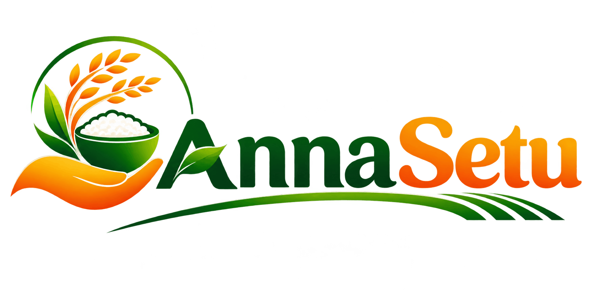

<p align="center">
  
</p>
<p align="center"><a href="https://projectannasetu.vercel.app"><strong>Live demo: projectannasetu.vercel.app</strong></a></p>

# AnnaSetu

**AnnaSetu** — Hyperlocal Surplus-to-Shelter Food Rescue Bridge (Hyderabad)

AnnaSetu is a static, single-page prototype of a seven-view operations suite. Caterers post surplus cooked food, the platform matches it to nearby NGO kitchens and shelters, and riders handle pickup and handover. All data is synthetic.

---

## Hackathon & Team

| Field | Details |
|---|---|
| Event | CodeBenders ACE Builders' Hackathon 2026 |
| Problem Statement | Problem Statement 2 \| Society and Environment — Rescue the Surplus |
| Team Name | Smash Buggers |
| Team Leader | Pranay Makkena |
| Team Member | Shwethan Kumar Anumalla |

---

## Problem & Focus

Wedding and event caterers in Hyderabad produce large volumes of surplus cooked food after an event. AnnaSetu focuses on the Madhapur, Gachibowli, Kondapur, Jubilee Hills, Hitech City and Banjara Hills corridor. Surplus cooked food is posted by a caterer, matched to a nearby NGO kitchen or shelter, and picked up by a rider.

The six localities are defined as `LOCALITIES` in `data.js`. Each has placeholder area-centre coordinates. NGO distances are fixed seed values (`distance_km`), not live map routing.

---

## Seven Operational Views

The sidebar lists seven views in this order. Each is opened by its `data-view` value.

1. **Caterer Portal** (`caterer`): the caterer's donation intake form and that caterer's batches.
2. **Live Dispatch** (`feed`): the dispatch feed of batch cards, with claim and stage actions.
3. **Corridor Radar** (`radar`): a schematic of the localities, showing open batches against the NGO pins, with route lines and rider tags.
4. **NGO Network** (`ngos`): the NGO cards with capacity, cold-storage and accept-time details.
5. **Safety & Handling** (`safety`): the remaining safe-hours countdown for each batch, colour-coded, plus the handling guide.
6. **Impact & ESG** (`impact`): the batch ledger, CSV export and the ESG summary.
7. **Business & ROI** (`roi`): the KPI cards and the unit-economics simulator.

---

## Seed Data

**NGOs (6, fictional).** Each phone number is a placeholder set in `data.js`.

| ID | Name | Locality | Phone (placeholder) |
|---|---|---|---|
| `ngo-asha` | Asha Community Kitchen | Kondapur | +91-XXXXX-00001 |
| `ngo-annapurna` | Annapurna Seva Trust | Madhapur | +91-XXXXX-00002 |
| `ngo-hope` | Hope Street Community Kitchen | Gachibowli | +91-XXXXX-00003 |
| `ngo-sahayam` | Sahayam Food Bank | Jubilee Hills | +91-XXXXX-00004 |
| `ngo-karuna` | Karuna Shelter & Elder Care | Hitech City | +91-XXXXX-00005 |
| `ngo-nirmal` | Nirmal Jyoti Youth Home | Banjara Hills | +91-XXXXX-00006 |

**Seed batches (10, `AS-1001` to `AS-1010`).** Values are from `data.js`. They cover the Posted, Claimed, Collected, Delivered and Expired states.

| ID | Dish | Diet | kg | Status |
|---|---|---|---|---|
| AS-1001 | Chicken biryani with raita | Non-Veg | 40 | Posted |
| AS-1002 | Veg thali (dal, paneer, rice, roti) | Veg | 55 | Claimed |
| AS-1003 | Vegetable pulao with sweet boxes | Veg | 30 | Collected |
| AS-1004 | Mixed dessert boxes | Veg | 12 | Delivered |
| AS-1005 | Hyderabadi Chicken Haleem & Naan | Non-Veg | 25 | Delivered |
| AS-1006 | Paneer Butter Masala & Naan | Veg | 36 | Posted |
| AS-1007 | Mutton Haleem & Bread | Non-Veg | 56 | Claimed |
| AS-1008 | South Indian Tiffin (Idli/Sambar) | Veg | 30 | Expired |
| AS-1009 | Chicken Dum Biryani & Raita | Non-Veg | 64 | Claimed |
| AS-1010 | Veg Biryani & Salan | Veg | 36 | Collected |

---

## Key Features

### Smart Match

- Each NGO gets a weighted score: **40% distance, 35% capacity fit, 25% diet fit**.
- Distance score: `max(0, 1 − km / 15)`.
- The factor breakdown shows the **top three** NGOs, with one bar each for Distance (40%), Capacity fit (35%) and Diet fit (25%).

### Split-batch claiming

- **Threshold:** a Posted batch of **150 or more meals** can be split. Batches below 150 meals use the normal single-NGO claim.
- **Allocator:** "Split Across NGOs" opens an allocator for up to **three Hyderabad NGOs** with remaining capacity, chosen by `splitCandidates`. Each NGO has a slider and a number input. Moving one value rebalances the others in proportion to their current shares, never above an NGO's remaining capacity. **Confirm** stays disabled until the allocations sum to the batch's meals. A **Close** button dismisses the allocator.
- **Parent status:** confirming marks the original batch **Split**. Its card shows "Split into N" and lists its children, with no countdown.
- **Child dispatches:** each allocation becomes a child batch with the parent's id plus **A, B or C** (for example `AS-1011A`). Each child is **Claimed** to its NGO, carries its own meals and kg, and shares the parent's rider. Each child's meals reduce that NGO's remaining daily capacity.
- **Corridor Radar:** each child draws its own route from the kitchen to its NGO.
- The allocator is the only split control; the earlier single-split control was removed.


### Pickup stages

- Stages: **Posted → Claimed → Collected → Delivered**.
- Claimed → Collected requires the self-attested checkbox "Core temp checked ≥ 60°C or chilled ≤ 5°C". No sensor or temperature value is recorded.
- Once a batch's deadline passes, any open batch (Posted, Claimed or Collected) becomes **Expired** and is locked.

### Persona workspaces

The header has a role select with four synthetic personas. **There is no login and no password.** Choosing a persona only switches the workspace.

| Persona | Organisation | Workspace |
|---|---|---|
| Ramesh K. | Deccan Royal Caterers | Kitchen view. Delivered batches can be downloaded as a CSR Impact Summary. |
| Meera S. | Annapurna Seva NGO | Receiver view. Veg batches are shown, and Delivered batches can be confirmed with a receipt. |
| Arjun V. | EV Rider R-07 | Rider mission. Arrive, temperature and seal log, then a 4-digit handover. |
| Vikram R. | TechPark CSR Sponsor | Sponsor console. Batches show a "Sponsor Open Rescue (₹40)" badge, and cost per meal is shown. |

**Live Dispatch is filtered per role.** Arjun sees his R-07 pickups. Meera sees the Annapurna summary and the Veg batches.

### Impact & ESG methodology (assumptions)

These are assumptions set in the code, not verified figures:

- **1 meal = 0.4 kg** (`MEAL_KG`).
- **2.5 kg CO2e per kg diverted** (`CO2_FACTOR`). This is an assumed factor, and the code gives no source for it.
- **₹65 per meal** (`MEAL_VALUE_INR`) is assumed for the caterer saving and value figures.
- Expired batches are excluded from ledger totals.

### Notifications and live demo

- Toast notifications appear for publish, claim, temperature check, delivery and expiry lock, and dismiss after 3.5 s.
- *Simulate Live Rescue* (in the hero) walks an open batch through Claimed, Collected and Delivered, one step every 1.8 s.

---

## Persistence

- State is saved in the browser's `localStorage` under the key **`annasetu_db_v2`**. The reset demo data action clears it.
- On load, a save older than **15 minutes** has its batch timestamps shifted forward by its age, so demo batches do not expire during judging. **AS-1008** and Expired batches are excluded from this shift and keep their saved times.

---

## Tech Stack

- Zero-dependency HTML5, CSS3 and vanilla JavaScript.
- Lucide icons are loaded from unpkg, so they need network access.
- No build step, no backend, no package manager (no `package.json`).

---

## Quick Start

**Option A — open directly**

1. Open `index.html` in a modern browser.

**Option B — serve locally with any static server**

```bash
python -m http.server 8000
```

Then visit <http://localhost:8000>.

Neither option was tested in this environment.

---

## Project Structure

```
AnnaSetu/
├── index.html         Page markup: header with role select, seven-view sidebar nav, and the view sections
├── styles.css         All styling: colour tokens, dashboard shell, cards, radar, responsive breakpoints, print layout
├── app.js             Application logic: state, Smart Match, split claim, pickup stages, expiry lock, rendering, CSV/ESG/ROI
├── data.js            Synthetic seed data: localities, NGOs, riders, food presets, seed batches, disclaimer text
├── AnnaSetuLogo.png   Logo shown in the header
└── README.md          This file
```

---

## Known Limitations

- The Impact figures are simulated from synthetic data.
- No browser check was done in the build environment.
- No authentication, no payments and no real routing. The role select is not a login.
- The phone numbers are placeholders.
- Browser-only persistence in `localStorage`; there is no server-side storage.
- Temperature verification is a self-attested checkbox; AnnaSetu does not verify food safety.

---

## Safety, Legal & Synthetic Data Guardrails

> All values, entities, coordinates, and metrics shown are synthetic for demonstration purposes. AnnaSetu coordinates logistics only, does not certify food safety, and makes no tax or legal benefit claims.

---

## License

Hackathon prototype — license to be decided by the team.

